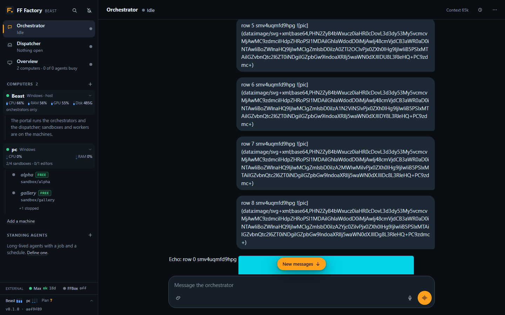
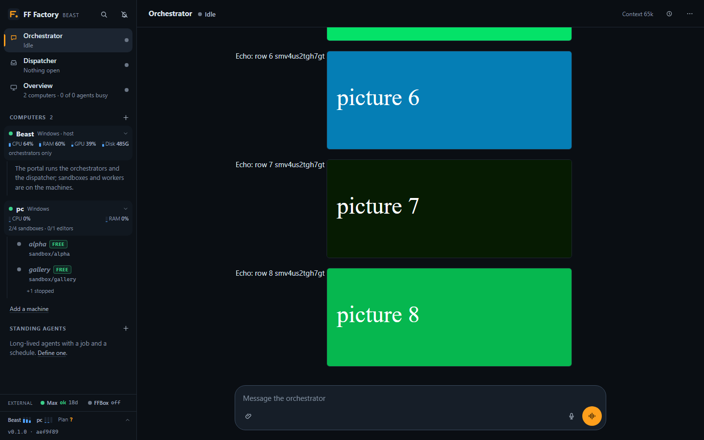
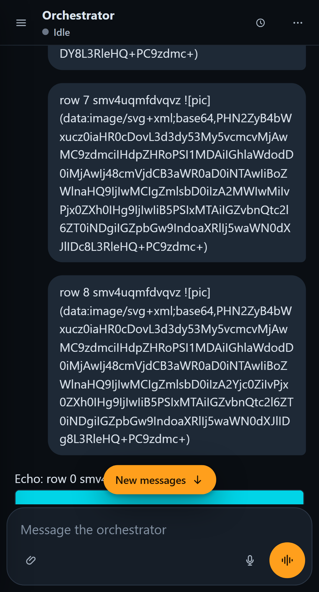
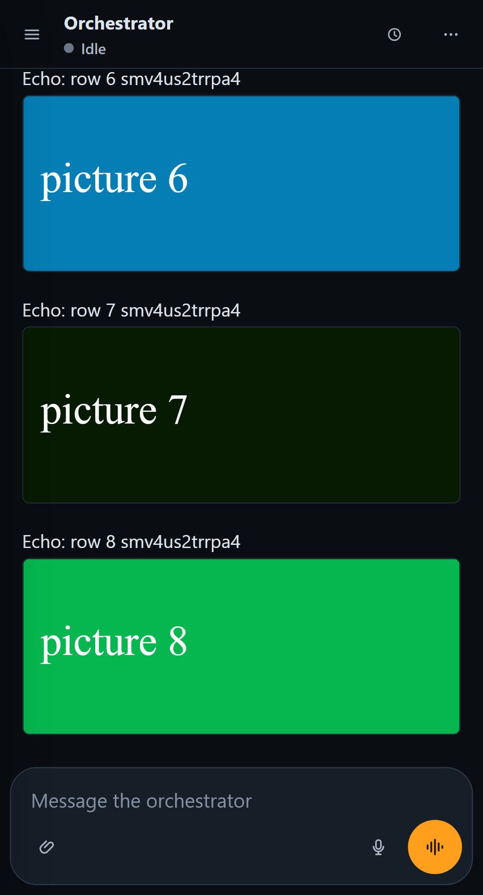
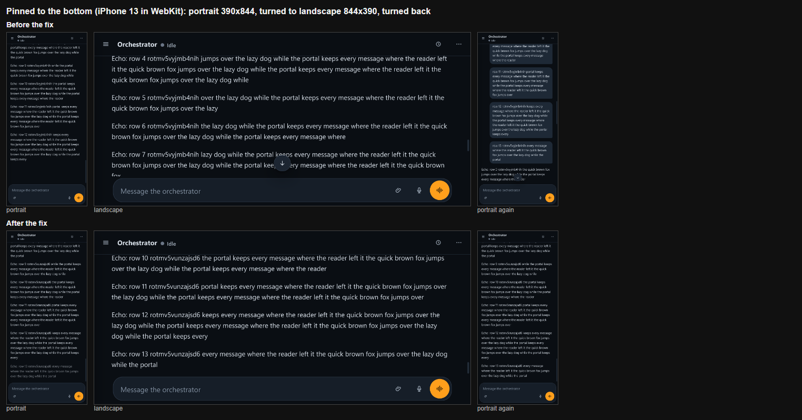
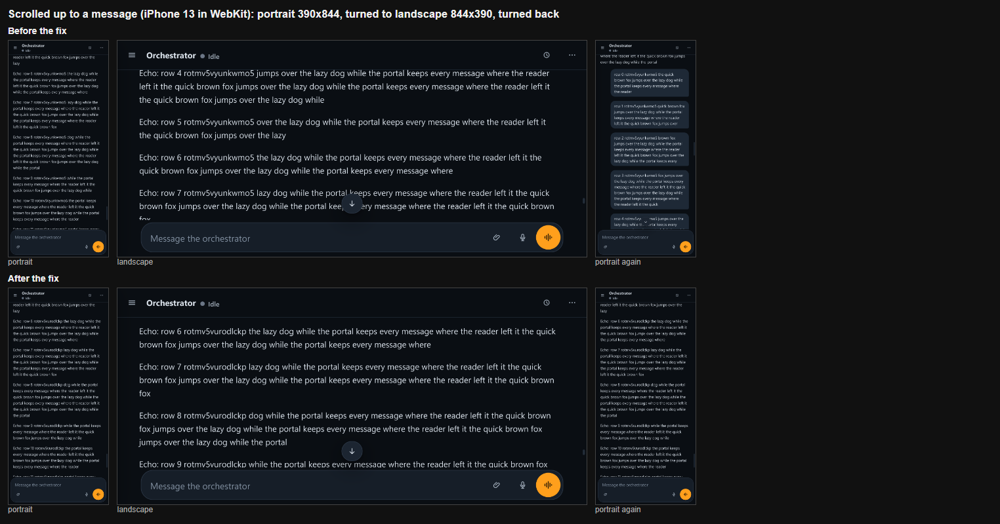

# UI review, 2026-09-24

A review of the web app as a user sees it, with the orchestrator chat first, then the at-a-glance
view of sandboxes, machines and agents, then phones. Findings are ranked by how much they get in
the way of that use. The plan for each is under it; the changes that landed are listed at the end.

## How it was looked at

The app ran against the mock backend in `web/mock/` (`npm --prefix web run build`, then
`PORT=8797 MOCK_FROZEN=1 npm --prefix web run mock`; any username, password `mock`). Its
scenario is a busy day: seven sandboxes (working, waiting for a permission, Unity blocked on a
dialog, idle, unused, creating, failed), two Macs (one online with a worker, one offline), three
standing agents with runs and delegation requests, and a long orchestrator conversation with tool
calls, harness notices, tables, code and images. `MOCK_SCENARIO=fresh` is the first-run state.

Screenshots were taken with Playwright at 1440×900 and 1920×1080 (Edge), 360×780 (Edge, Android),
390×844 and 430×932 (WebKit, iPhone) and 844×390 landscape (WebKit), 24 states each. They are on
the host under `F:\ffsb\agent-mcp\Logs\ui-review\before\<size>\<state>.png`, with
`<size>` one of `d1440 d1920 p360 p390 p430 land`. The names below are relative to that folder.

## Findings

### 1. The sidebar hides the sandboxes (high)

At 1440×900 the sandbox list starts 525 px down and shows one and a half sandboxes
(`d1440/orch.png`). Above it sit the brand, two nav rows, five system meters and three plan
meters. Each sandbox card is about 160 px: label, `slot: agent-mcp`, branch and git summary, a
Unity chip, then one row per agent with its session id. On a phone the drawer shows two and a half
cards per screen (`p390/drawer.png`).

The card's dot is the sandbox's provisioning status, which is green for every ready sandbox. What
the sandbox is doing (an agent working, one waiting for Ben, Unity stuck) is spread over the chip,
the agent dots and a badge, so "Play the tutorial…" reads green while its editor is blocked.

Plan: two-line rows. First line: a state dot and the label. Second line: the state in words, the
active agent's name (left out when it repeats the label) and Unity when it matters. The state is
worked out from the agents and the editor, most urgent first. Meters fold into a one-line footer
that opens on a tap. One `+` per section; the second "New sandbox" button goes.

### 2. "Needs you" undercounts and names one thing (high)

The count is permission requests plus delegation requests. A Unity editor stuck on a dialog is not
counted, although it cannot continue without someone at the desktop. The sidebar box names only
the first item ("2 waiting on you · Honest co-op client (BEAST) · Bash").

Plan: an attention list at the top of the sidebar with every item on its own row: the permission
(agent, tool, command), the blocked editor (sandbox, dialog title) and the delegation (agent,
title). One tap goes to the place. The tab title and the phone's bell use the same count.

### 3. Tool calls crowd out the conversation (high)

Every tool call is a full-width bordered row in monospace. A typical orchestrator turn is two or
three of them before a one-line reply (`d1440/orch.png`); a worker's transcript is mostly tool rows
(`d1440/sandbox-working.png`). On a phone they are cut to `sandboxes · agent_transcript session=…`
(`p360/orch.png`).

Plan: each run of tool calls and thinking between two replies becomes one collapsed line, "Used 3
tools: list sandboxes, list standing agents, list delegation requests", which opens to today's
rows. A failed call shows in that line. Screenshots a tool returned stay visible under it. While a
turn runs, the line names the tool in flight.

### 4. Harness notices read like log lines (high)

`[worker update]`, `[heartbeat]`, `[unity blocked]`, `[auto-delegation]`, `[standing agent]` and
`[wake_me]` messages are shown folded like thinking, in dim italics, with the raw text as the
preview: `agent "Lighting pass (AAA space look)" (session s-light-1) in sandbox agent-mcp finished a
turn…` (`d1440/orch-history.png`). The label wraps to two lines on phones ("Worker / update",
`p390/orch-history.png`). `[unity blocked]` and `[auto-delegation]` get the label "Worker update".
Nothing sets apart the notices that need Ben: a worker waiting for permission, a blocked editor, a
delegation request.

Plan: one compact row per notice with an icon for its kind, a one-line summary that uses names
("Lighting pass (AAA space look) finished a turn"), the time and a link to the sandbox or agent. The
ones that need Ben are amber. Expanding shows the full text. The parsing lives in
`shared/notices.ts` with tests.

### 5. Per-turn metadata in the reading flow (medium)

A rule with "Done · 3 turns · $0.14 · 16s" closes every turn, and the header shows the model id,
the session's running cost and the last activity (`d1440/orch.png`). None of it helps read the
conversation.

Plan: no rule after a turn that ended normally; failures, budget stops and interrupts keep theirs.
The reply's time, duration and cost show on hover. Model, cost and turn count move to the chat's
menu.

### 6. Phones: two header rows and truncated names (high)

The orchestrator on a phone has the top bar plus a second row that holds a status dot, the
heartbeat select and the permission-mode select (`p390/orch.png`). On a sandbox page the one header
row holds both the label and the agent picker, so both are cut: "Lighting pas…" next to "Lighting
pass (AA" (`p390/sandbox-working.png`), "Play the tutor…" next to "Tutoria" and a red "Unity" pill
(`p390/sandbox-blocked.png`). In landscape the two header rows and the composer leave about 170 px
for the conversation (`land/orch.png`).

Plan: one header row. The orchestrator's heartbeat, permission mode and "new conversation" go into
a `⋯` menu in the top bar. The sandbox header gets the label on its first line and the agent (with
its state) as a tappable second line; a permission wait or a blocked editor shows as a strip under
the header that says what is wrong. The composer uses one row when the screen is short.

### 7. The details sheet scrolls sideways on phones (high)

The Unity dialog text contains a long path that does not wrap, so the sheet scrolls horizontally
and "Stop Unity" is cut off (`p390/sandbox-details.png`). The sheet shows the sandbox label twice.
A blocked editor is amber in the sheet and red in the header.

Plan: wrap long tokens; one title; one colour per state everywhere.

### 8. Missing chat idioms (medium)

- Code blocks have no copy button.
- Replies have no time; user bubbles always show one. There are no day or time separators, so a
  morning's messages and last night's look the same.
- "Jump to latest" appears only when new content arrives while you are scrolled up, not when you
  scroll up yourself.
- Opening a sandbox and coming back puts the chat at the bottom; on phones it is re-mounted.
- On desktop the composer is not focused when the page opens.
- The placeholder carries keyboard help ("Enter to send, Shift+Enter or Ctrl+Enter…").
- Stop is a separate red pill beside the primary button.

Plan: copy buttons; times on hover and a divider when more than 15 minutes pass; the pill whenever
you are more than a screen from the bottom, saying "New messages" when there are some; scroll
position kept per chat; focus on load on desktop only; a short placeholder; while a turn runs and
the box is empty, the primary button is Stop, with voice mode still one tap away.

### 9. Contrast (medium)

`--text-3` (#687686) is used for timestamps, meta, placeholders, section heads and thinking. It is
4.17:1 on the page, 3.85:1 on panels, 3.62:1 in the composer and 3.33:1 in the user bubble. WCAG AA
asks 4.5:1 for text this size (11 to 12.5 px).

Plan: lighter `--text-3` and `--text-2` that pass 4.5:1 on every surface, keeping the difference
between the two.

### 10. Type and spacing drift (medium)

The stylesheet uses twelve font sizes between 10.5 and 17 px and spacing values from 2 to 7 px in
most combinations. Almost every container has a border, and states are drawn with dots, chips,
pills and badges that differ per page.

Plan: tokens for a 4 px spacing grid and a seven-step type scale (11, 12, 13, 14, 15, 17, 22 px);
fewer borders, one status component (dot plus words) and one badge.

### 11. Ids where names should be (medium)

Session ids next to agent names in the sidebar, `slot: …` on every card, "(slot sb-5)" in dialog
titles, search hits labelled `slot agent-mcp`. The labels-as-names change made the label the name;
these places did not follow.

Plan: names everywhere; ids in the details sheet and tooltips.

### 12. Smaller things (low)

- The settings dialog scrolls sideways on phones (`p390/settings.png`).
- Search filters take half a phone screen and the date inputs have no visible label
  (`p390/search.png`).
- Sign out sits next to settings in the sidebar header, one tap from a mistake.
- Connection state is a 7 px dot; a lost connection deserves words.
- An unused sandbox's page offers only "New agent" (`p390/sandbox-unused.png`).
- A failed sandbox shows the raw git error with no next step (`d1440/sandbox-error.png`).

## What works and stays

Voice mode (one big word, the orb, tap anywhere to end) suits the car. Permission cards are clear
and their buttons are thumb-sized on phones. Details live in a sheet, labels are names, drafts are
kept per chat, Enter and Shift+Enter behave as expected, and the lightbox pages through images.

## What changed

All twelve findings were acted on; see the commits from "Harness notices, parsed for the page" to
"E2E: new visual baselines". The after screenshots are in `…\Logs\ui-review\after\` with the same
names as the before ones, and `…\Logs\ui-review\interact\` has the states a click leads to (the ⋯
menu, an opened tool line and notice, a reply streaming, "New messages", a live permission request,
the phone's bell opening the drawer, "Unity is stuck" opening the details, voice mode).

| | Before | After |
|---|---|---|
| Orchestrator, desktop | `before\d1440\orch.png`, `orch-history.png` | `after\d1440\orch.png`, `orch-history.png` |
| Orchestrator, phone | `before\p390\orch.png`, `land\orch.png` | `after\p390\orch.png`, `land\orch.png` |
| Sidebar | `before\d1440\orch.png` (left), `p390\drawer.png` | `after\d1440\orch.png` (left), `p390\drawer.png` |
| Sandbox page, desktop | `before\d1440\sandbox-working.png` | `after\d1440\sandbox-working.png` |
| Sandbox page, phone | `before\p390\sandbox-working.png`, `sandbox-details.png` | `after\p390\sandbox-working.png`, `sandbox-details.png` |

Not redesigned: the standing agent's page (only its facts line and names changed).

`web/mock/server.ts` also serves the new build for these screenshots; the E2E suite
(`npm run test:e2e`) follows the new layout, and its Linux baselines were re-rendered by CI.

## iPad with a hardware keyboard (added during the work)

Ben's report, in Chrome on an iPad with a hardware keyboard (1366 x 1024 CSS px): focusing a composer
floats an AutoFill bar (key, card, pin) at the bottom and shifts the page up. The first fix (form
attributes, the app fitted to the visual viewport) made it worse: the bar stayed, since Chrome for iOS
ignores `autocomplete="off"` for it (Chromium issue 442607855, cited in corveil/crow#1263), and iOS
counts about 164 px at the bottom as covered while most of it still shows the page, so an app fitted
to the visual viewport left a dead band under the composer.

- The composer's message box is a `contenteditable="plaintext-only"` div, not a textarea
  (`web/src/editable.ts`, `web/src/components/Composer.tsx`): role `textbox`, `aria-multiline`, no
  autocomplete or password-manager attributes, not in a form. Chrome for iOS reports "form activity"
  (what brings up its AutoFill bar) for `FORM`, `INPUT`, `SELECT`, `OPTION` and `TEXTAREA` only
  (`FORM_TAGS` and `formActivity()` in Chromium's
  `components/autofill/ios/form_util/resources/form_handlers.ts`); contenteditable elements count only
  behind `kAutofillSupportContentEditableIos`, which is `FEATURE_DISABLED_BY_DEFAULT`
  (`components/autofill/ios/common/features.mm`, Chromium main on 2026-09-24). Enter and Shift+Enter,
  image paste and drop, dictation at the caret, drafts, the placeholder, the capped height with its own
  scroll and IME input all work as before. A browser without `plaintext-only` gets
  `contenteditable="true"` with pastes and drops made plain and formatting blocked. The new-agent and
  standing-agent dialogs keep their textareas.
- `web/src/viewport.ts` keeps the app at the layout viewport's height unless more than 30% of the
  screen (at least 120 px, at most 200 px) is covered, which only an on-screen keyboard does (an
  iPad's takes 300 px or more). A hardware keyboard's bar floats over the full-height app. The app
  follows Safari's pan either way, so the header stays on screen. The same rule decides Enter: a
  hardware keyboard sends, an on-screen keyboard makes a new line.
- The caret: after the page moves, the focused box's selection is set again where it is (iOS may go on
  drawing the caret where the box was), and a layout box that holds the focused field is no longer
  scrolled back while the field has the focus (it is once the focus leaves).
- `e2e/ipad.spec.ts` runs in two projects, `ipad-safari` and `ipad-chrome` (Chrome's `CriOS` user agent;
  Chrome for iOS is WebKit), with a stand-in `visualViewport`. It checks that the box is a
  contenteditable without autocomplete attributes; that the app keeps the layout's height under a 60
  or 164 px bar, panned or not; that it fits above a 396 px keyboard with the header in place; that the
  caret stays in the box, at the same place and on screen, through each move; that keys typed while the
  page moves stay in order (an earlier draft, which put back a Range saved before the move, typed "zxy"
  for "xyz"); and Enter under a bar and with the keyboard.

What only a real iPad can show: whether Chrome's AutoFill bar is gone for the contenteditable box (per
Chromium's source it should be, unless that flag is on for some users); how much iPadOS still counts as
covered with the hardware keyboard (the app takes anything up to 200 px for a bar); whether iPadOS's
floating bar covers the Send button (Enter sends then); and whether Safari or Chrome pans the page for
the box at the bottom under the bar (the app follows a pan, so the header should stay).

## Leaving a page and coming back keeps the place (w1100)

lothsahn, 2026-10-12: "When I switch to the dispatcher pane and then back to the orchestrator pane, it loses my position
in the conversation and I have to scroll all the way to the bottom of the orchestrator pane again."

The cause was in `web/src/components/Transcript.tsx`, the `onScroll` handler. It decided "at the bottom" from the page's
geometry at the time of the scroll event, and the chat remembered its place per session as a pixel offset. A chat that is
drawn again (every page switch draws the other pane's chat from the store) grows after it is drawn: pictures load lazily
(`loading="lazy"` in `Markdown.tsx`), so a chat that has pictures lengthens by several screens over the second or two after the
mount. A scroll event that arrived after some of that growth saw "400 px from the bottom", took it for the reader scrolling
up, and set `atBottom` false. The `ResizeObserver` that follows growth only follows while `atBottom` is true, so the chat was
left where it was, with "New messages" showing, and the reader had to scroll down by hand. Reproduced before the fix: a chat of
12 messages with pictures, opened fresh, ended 3,000 px above its bottom.

What it does now:

- A scroll event after the content grew, with nothing scrolled up, is the page growing: the chat that was following the end
  goes on following it.
- A chat scrolled up is remembered by the message at the top of the view (its `seq`) and how far below the top that message
  sits, not by pixels, which mean something else once the pane is narrower (the Dispatcher page puts the orchestrator beside
  it) or its pictures are not loaded yet. It is put back on that message, and held there against late content until the
  reader scrolls, touches or presses a key (4 s at most). If the chat has loaded without that message (older than the 500
  events fetched), the pixel offset is the fallback.
- "New messages" shows on the way back only when something newer than what the reader had seen has come in; it no longer
  shows on every return to a scrolled-up chat.
- The lists that were drawn only while open (the Dispatcher's Requests and Intake, the Overview board, Max, a standing agent's
  runs and delegations) keep their scroll position through `web/src/scrollKeep.ts`. They never had any: they were at the top on
  every return.

`e2e/scrollKeep.spec.ts` covers it in the desktop, Android Chrome and iPhone Safari projects (the Intake tab's is in
`e2e/intake.spec.ts`): the orchestrator across the Dispatcher page, a worker in a sandbox panel across the Overview, a worker on
its full-width page, the dispatcher's own conversation across its tabs, and the Requests list and Overview board. The chats are
filled with pictures, because a chat without any returns to the bottom even with the bug. Each chat is checked pinned to the
bottom (with a message that came while away), scrolled up to a message (the same message in the same place, and "New
messages"), and once more with nothing new. All six chat and list tests fail without the fix.

Before and after (a chat of nine messages with pictures, left for the Dispatcher page and back; desktop, then Android Chrome):

| | before | after |
|---|---|---|
| desktop |  |  |
| phone |  |  |

## Turning the phone keeps the place in the chat (w1164)

lothsahn, 2026-10-12: "When my phone switches between horizontal and vertical layout the position in the chat changes and I
have to scroll down. Please make it keep the position in the chat."

Two causes in `web/src/components/Transcript.tsx`, both measured by logging scroll, resize and `ResizeObserver` events while
the view went from 390 x 844 to 844 x 390 (Playwright, `e2e/rotate.spec.ts`):

- **Pinned to the bottom, WebKit (iPhone Safari, and every iOS browser).** A resize relays the chat out and WebKit moves the
  scroll position to fit, firing a `scroll` event before the `ResizeObserver` runs. In that event the chat was 454 px from the
  bottom, so `onScroll` took it for the reader scrolling up and set `atBottom` false. The `ResizeObserver` that re-pins the
  chat only does so while `atBottom` is true, so the chat stayed 454 px above its end and "jump to latest" showed. Chrome
  fires no scroll event there (its anchoring and clamping moved the position inside the layout step), so it already re-pinned.
- **Scrolled up, every browser.** Nothing put the reader back. The scroll position was kept as pixels while the rows wrapped
  differently, so another message sat at the top (Chrome: 85 px off, WebKit: 133 px on the way into landscape, and thousands of
  px on the way back).

What it does now:

- `onScroll` ignores a scroll event that arrives with the view's size changed since the last look (`lastBox`): the layout moved
  the view, not the reader, so `atBottom` and the remembered place stay what the reader left.
- The `ResizeObserver` handles a resized view: pinned, back to the bottom; scrolled up, the message that was at the top of the
  view (the place already remembered by `seq` and offset for w1100) goes back where it sat, and is held for 1.5 s
  (`RESIZE_HOLD_MS`) so the scrolling that does is not taken for the reader moving (a message that was partly above the top edge
  may be wholly above it once it wraps shorter, which would make the next message the place to return to).
- The same code serves any resize of the chat's box: the on-screen keyboard (iOS shrinks `--app-h`, Android shrinks the
  layout), a window resize, a side panel opening.

`e2e/rotate.spec.ts` (Android Chrome and iPhone Safari projects) turns a long chat 390 x 844 -> 844 x 390 -> back and the other
way round, pinned (still at the bottom after each turn) and scrolled up (the message at the top of the view within 3 px of where
it was after each turn). Without the fix 6 of its 8 tests fail (the 2 that pass are Chrome pinned, which never broke); with it
all 8 pass. Not covered: the keyboard itself (the existing `moveViewport` fixtures simulate iOS's visual viewport; the box-size
path they take is the one the turn takes).

Before and after, iPhone 13 in WebKit, turned to landscape and back:

